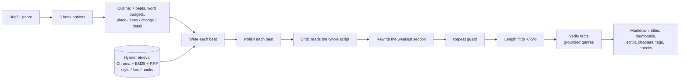

# Story Script RAG

Local, offline RAG system that writes first-person YouTube story scripts (horror, history mysteries, fantasy,
Cthulhu, sci-fi, literary, or any genre you name) at a chosen length of 5, 10, 15 or 20 minutes. Everything is free and runs on one
consumer GPU (built and measured on an RTX 5060 Ti 16 GB, peak VRAM under 14.5 GB). The LLM runs on the GPU through
Ollama; embeddings, ChromaDB and BM25 run on the CPU.

## How it works

- **Three collections:** `scripts` (style examples), `lore` (facts) and `hooks`. Each is searched with dense vectors
  (bge-m3) and BM25, merged by reciprocal rank fusion, filtered by genre and by story beat.
- **Outline with logic fields:** every beat has a word budget plus `place` (where the narrator's body is), `sees` (what he looks at, e.g. which screen), `change` (what is new) and `detail` (which recurring detail it uses). Code checks the outline for holes and asks for one repair.
- **Section by section:** each beat is written with a rolling summary and the unused budget of earlier beats, then polished on its own. A whole-script polish made the 12B model loop, so it is not used.
- **Grounded history:** for fact-based genres the model tags facts `[S#]` (the lore chunk they came from) and wraps
  anything it invents as `{{INVENTED: ...}}`. A Verify step re-checks every sentence that carries a `[S#]` tag, plus sentences naming something with no citation, against the lore (at most 40 checks).
- **Rewrite pass:** after polish, one critic call lists logic holes in the whole script. The section with the most issues (logic holes, a past/present tense switch, extra `[PAUSE]` cues, repeated or banned phrases) is rewritten once; the rewrite is kept only if it has fewer code-detectable issues.
- **Guards:** repeated paragraphs, paragraphs that retell an earlier one in new words, and repeated sentences are removed; the final length is steered to within 5% of the target; passages with over 80% 5-gram overlap with a source are flagged.

## Results
Measured on this machine (num_ctx 16384). Single runs; quality metrics swing a few points.

| Check | Result |
|---|---|
| Retrieval, 17 briefs (`cli.py eval --retrieval-only`) | right source at top 1: 0.87, top 3: 0.91, top 10: 0.91; 16 of 17 briefs hit (b10 misses). Top 3 was 0.96 before 29 more horror stories entered the index |
| Three briefs (horror / history / cthulhu), 5 min, target 750, after the outline-logic update | accuracy 97.1% mean (736-780 words), repeats 3.1% mean, no tense switches, 1.0 `[PAUSE]` per minute, sentences 15.6 words |
| Fantasy 5-min script, two runs on gemma4:12b | 753 / 762 words, accuracy 99.6% / 98.4%, repeats 0.3% / 1.6%, sentences 14.8 / 14.9 words, peak VRAM 10.7 GB |
| History 5-min script, after the Verify upgrade | 722 words (accuracy 96.3%), repeats 4.3%, 14 sentences marked `{{INVENTED}}` |
| Sci-fi 5-min script, after the refine pass | 759 words (accuracy 98.8%), repeats 1.6%, no tense switches |
| Speed | about 2.5-7 min per 5-min script; generation is decode-bound at ~40-45 tokens/s |
| Offline tests (no GPU, no Ollama) | 79 pass, including an end-to-end repeat guard that fails if the dedupe is removed |

Unedited excerpt (history, "The Mary Celeste", gemma4:12b; `{{INVENTED}}` marks claims the lore does not support, `[S1]` marks facts that do):
> On December 4, 1872, the *Dei Gratia* spotted her sailing erratically in the Atlantic [S1]. No one answered their signals, and a boarding party found the ship completely deserted [S1].
> {{INVENTED: The captain's log ended abruptly, leaving a haunting void in the official record.}}

## Design decisions (what I tested and why)
- **Cross-encoder reranker: tested and removed.** A MiniLM reranker gave no ranking gain and was 5x slower on CPU.
- **Parallel polish: 2 workers, not 3.** Three workers reached 14.8 GB VRAM, over the 14.5 GB budget (polish 18.7 s to 12.0 s with two).
- **Per-beat polish, not whole-script.** The whole-script call made the model repeat paragraphs.
- **Repeats are guarded by tests, not hope.** A fake-LLM test re-tells earlier scenes and fails if any repeat reaches the script; a second test breaks the dedupe on purpose to prove the guard can fail.
- **Length control.** The model wrote 3-5x small budgets, so generation is capped at about 1.8 tokens per word of budget and polish may grow a section by at most 15%. The final fit accepts a rewrite only if it moves toward the target and adds no repeats, and runs when the script is more than 5% off (a 10% tolerance once let 823 words pass for a 750 target).
- **Sentence length needs an example, not another rule.** Five prompts already asked for 10-15 words and the model wrote 7.9; a before/after example plus a self-check moved it to 12-13.
- **The rolling summary is labelled "already told".** Labelled "Summary" the model retold it; relabelling cut repeated phrases from 8.8% to 2.2% in one run.
- **Recurring details are allowed, but limited.** A repeated sound or smell makes a place real, so each outline detail may come back at most 3 times (`checks.motif_max`), in different beats, changed each time (how it sounds, what it does to the narrator, what it means). A prompt example shows a copied return and a changed one. The report lists details that return in the same words and counts the paragraphs that bring back each outline detail.
- **Outline logic fields.** Without them the narrator was in two places at once. `place` is where his body is, `sees` names the screen he watches (he stays at it; what it shows stays on it). Code flags a beat with no place or change, two beats adding the same thing, and a detail used twice in a row or in more than 3 beats, then asks for one repair, kept only if it has fewer holes. A critic call reads the finished script for logic holes; its rewrite is not verified by code, and the Checks note says so.
- **Reworded retellings are caught by content words, not phrases.** `dedupe` drops a paragraph when at least half of its content words occur in one earlier paragraph (threshold `checks.dedupe_similar` = 0.5; real retellings scored 0.55 and 0.75, ordinary pairs 0.37 or lower). On saved scripts it cut repeat rates from 6.7% to 4.0% and 4.9% to 0.8%.
- **The repeat guard runs before the length fit.** Run after the fit, it deleted a retold section and one run finished at 584 of 750 words. Now an emptied section is made up by the fit, and a retelling also triggers a retry. A test fails on the old order (660 words).
- **The outline runs without thinking (`llm.think_outline: false`).** With thinking on, one run spent 185 s and the whole token budget with no JSON. Turn it on in `config.yaml` for one thinking attempt before the plain ones.
- **One sentence splitter** (`text.sentences()`): two checks once split "J. Habakuk" differently and a mid-sentence `[S1]` tag cut a claim in half before Verify.
- **Invented bracket notes are stripped.** Only `[PAUSE]`, `[SFX:]`, `[B-ROLL:]` and `[S#]` survive.
- **gemma4:12b is the writing model** (with BAAI/bge-m3 for embeddings; models are not included and have their own licences). Against the model it replaced it had better accuracy, fewer repeats and lower peak VRAM, but it is 2-3x slower and its sentences run long (14.8-14.9 words).

## Code layout
- `ragscript/pipeline.py` orchestrates: hooks, outline (with repair), then the stage modules. Dependencies are passed in (`Pipeline(cfg, retriever, llm)`); `Pipeline.from_config()` builds the real ones. Every model call carries its stage name (`llm.chat(prompt, stage="outline")`), so test doubles never match on prompt text. It also saves `<script>.trace.json` (outline, drafted and refined sections) next to each script. `story.py` is the shared `Story` context; `prompts.py` fills the `<<placeholders>>` of stage templates.
- `ragscript/draft.py`: `Drafter.draft` writes the sections beat by beat (retrieval per beat, rolling word budget and summary, one corrective retry).
- `ragscript/refine.py`: everything after a section is drafted. `draft_issues()` and `final_issues()` return `Issue(kind, message)` records; `attempt()` keeps a rewrite only if it is better; `Refiner.run` does polish, the critic, the rewrite of the worst section, the repeat guard and the length fit.
- `ragscript/grounding.py`: `[S#]` citations, the `{{INVENTED: ...}}` marks and the Verify step. `text.py` has the one sentence splitter; `checks.py` the checks on the narration (repeats, overlap, tense, crutch words, outline holes, detail returns). Every threshold comes from `config.yaml`.
- `ragscript/report.py` + `render.py`: `Report` holds every measurement of a finished script and decides which warnings to show; `render` turns a `Doc`, the script and the `Report` into markdown. A new check is a field in `Report` and a line in `render`.
- `ragscript/store.py` + `retrieve.py` + `ingest.py`: `Store` is the search index (Chroma plus BM25), `Retriever` fuses the two rankings, `Ingest` fills the store from `data/` and saves progress after every file. `chunking.py`, `loaders.py`, `metadata.py` feed `ingest`; `sources.py` numbers the cited chunks.
- `ragscript/llm.py` (Ollama, OOM retry), `genre.py`, `vram.py`. Entry points: `cli.py`, `app.py`. Tests share `tests/support.py` (fake model, fake retriever, `make_pipeline`).
- `config.yaml` holds every tuning number (`style:`, `length:`, `checks:`); `prompts/` holds the stage and genre prompts.

## Limitations
- Single user, single machine; no concurrency design beyond the polish step.
- Retrieval is judged on 17 briefs; script quality on a 3-brief check plus reading, not a user study.
- Average sentence length is about 15-16 words (target 10-15); gemma4 runs at the long end. Read aloud before recording.
- The Verify step is strict: it can mark a true paraphrase as `INVENTED`.
- Repetition is reduced, not solved: repeated-phrase rates over recent horror runs ranged from 1.9% to 6.7%, so one run proves little. The 12B model still reuses wording for recurring details, and the critic's logic rewrite is not checked by code.
- Retrieval ranks shift as the corpus grows: 29 more horror stories moved top-3 from 0.96 to 0.91.
- History facts come from a small set of lore notes (10 topics). Fact-check every `{{INVENTED}}` mark and the Checks section before publishing.
- The books and scripts used as style data are **not** in this repository.

## Setup
Needs Python 3.11 to 3.13 and Ollama (https://ollama.com).

**Data is not included.** Put your own `.txt .md .docx .pdf .epub` files in `data/<genre>/` (for example
`data/horror/`), name fact notes `lore_*.md`, then run `python cli.py ingest`. Use only text you have the right to use.

Windows PowerShell:
```powershell
.\setup.ps1                  # venv, CPU torch, requirements, ollama pull gemma4:12b
.\.venv\Scripts\Activate.ps1
```
Linux: `bash setup.sh && source .venv/bin/activate`

bge-m3 (~2 GB) downloads on first ingest; after that everything runs offline.

## Use
```bash
python cli.py ingest                                   # incremental: only new/changed files are re-indexed; an interrupted run resumes
python cli.py hooks "A lighthouse keeper finds extra footprints" --genre horror
python cli.py write "The lost colony of Roanoke" --genre history --minutes 10 --hook 2
python cli.py write "A tech finds the ship AI is lying" --genre sci-fi --style "wry, practical details" --minutes 5
python app.py                                          # Gradio UI at http://127.0.0.1:7860
python cli.py eval [--retrieval-only]                  # 17 briefs in eval/briefs.yaml; a full run adds word accuracy, repeats, `[PAUSE]` per minute, tense switches, sentence length and detail returns over the limit
python cli.py eval --ids b01,b03,b08 --minutes 5 --label NAME   # quick regression: 3 real scripts -> output/NAME/ + stats.json
python -m eval.lore_check data/history/lore_*.md       # before ingesting lore: garbled text, front-matter, length, names/years seen once
pip install -r requirements-dev.txt && python -m pytest tests   # model-free self-checks
```
Output goes to `output/<genre>-<min>min-<slug>-<MMDD-HHMMSS>.md` (a rerun never overwrites an earlier script): titles (5), thumbnail text (3), narration with
`[PAUSE]` / `[SFX: …]` / `[B-ROLL: …]` (the `## Script` section is clean: no `[S#]` tags, no `{{INVENTED}}` braces, ready to record), estimated chapters, description, tags, sources, and a Checks section. Grounded genres end with a **Fact-check copy** that keeps every `[S#]` tag and `{{INVENTED}}` mark.

## Any genre
`--genre` (or the UI box) takes any name: "sci-fi", "true crime", "romance"… The name is lower-cased and hyphenated (`True Crime` → `true-crime`).
- Examples: put files in `data/<name>/`, then `ingest`. No folder means no style examples, but it still works.
- Rules: optional `prompts/<name>.md`. Without it, `prompts/default.md` is used (a warning is logged).
- Fact-grounded genres (true crime, science, biography): start the prompt file with `---\ngrounded: true\n---`. Facts then come only from `lore_*.md` notes, and invented details are marked `{{INVENTED: …}}`. `history.md` does this already.
- `--style "…"` / the UI field adds one-off style notes for a single script.
- The narrator is always first person and the story always uses the 7 beats.

## Adding your material
Drop files (`.txt .md .docx .pdf .epub .srt .vtt`) in `data/<genre>/`, then run `ingest`. Keep the original books outside `data/` (this project uses a gitignored `sources/` folder); one file per story gives better style examples than one file per book.
- Books: EPUB chapters are read in reading order; Project Gutenberg headers/footers, PDF page numbers and line-break hyphens are removed automatically (if poppler's `pdftotext` is on PATH it is used). Scanned PDFs need OCR first.
- **Past scripts** → style collection. Optional YAML front-matter: `subgenre, tone, pov, views, retention`. Missing tags are filled once by the LLM (cached by file hash).
- **Lore/facts** → name the file `lore_*.md` (or front-matter `kind: lore`).
- **Hooks/endings** → `data/hooks/*.md`: blocks separated by a `---` line, first line `TYPE: hook` or `TYPE: ending`.
- Beat chunking uses `## Hook / Setup / Rising tension / Reveal / Climax / Aftermath / Outro` headings (or `[BEAT: climax]`). Without them, 300-500 token chunks with 15% overlap are used and beats are estimated from position.
- Delete a file and the next `ingest` removes it from the index.

## Customising
- `config.yaml`: model, `num_ctx`, retrieval sizes, words per minute, `style:` targets (sentence length, `[PAUSE]` limit), and the `length:` and `checks:` thresholds the results were tuned with.
- `prompts/<genre>.md` genre rules; `prompts/stages/*.md` stage templates (placeholders look like `<<name>>`).
- `banned_phrases.txt`: one phrase per line; used in the prompts and checked after generation (one rewrite attempt, then listed in Checks).
- Swap model: `ollama pull mistral-nemo` then set `llm.model: mistral-nemo`. Models without thinking support are detected automatically.

## Fact-checking and quality checks
Grounded genres take facts only from retrieved lore (`[S#]`); anything invented is wrapped as `{{INVENTED: …}}` and listed under Checks. After polishing, the **Verify step** asks the model YES/NO ("does the lore state this?") for every cited sentence and every sentence that names something without a citation (at most 40 checks); each NO becomes `{{INVENTED}}`. This reduces but cannot eliminate invention, and paraphrases can be mis-marked: fact-check before publishing. The lore notes are paraphrased from Wikipedia (each file's front matter names the source and check date), so verify them too.

Every output also reports word-count accuracy, repeated-phrase rate, average sentence length, banned-phrase hits, passages with >80% 5-gram overlap with a source, details that return in the same words, the paragraphs that bring back each outline detail (flagged above `checks.motif_max` = 3), crutch words, past/present tense switches and `[PAUSE]` density. The last three only report; the weakest-section rewrite fixes tense, `[PAUSE]` and repeat problems automatically.

## Optional: parallel polish
To polish 2 sections at once, set the Ollama server variable `OLLAMA_NUM_PARALLEL=2` (PowerShell: `[Environment]::SetEnvironmentVariable("OLLAMA_NUM_PARALLEL","2","User")`, then restart Ollama) **and** `llm.parallel: 2` in `config.yaml` (peak GPU 11.8 → 13.3 GB). Undo with `SetEnvironmentVariable("OLLAMA_NUM_PARALLEL",$null,"User")`.

## VRAM troubleshooting
Every stage logs VRAM/RAM and warns above 14.5 GB. On out-of-memory the LLM wrapper halves `num_ctx` (down to `llm.min_ctx`) and retries. If it still fails: lower `llm.num_ctx` (12288/8192), set `llm.keep_alive: 0`, close other GPU apps, or use a smaller model. Embeddings are CPU-only.

## Built with AI assistance
This project was developed with the help of AI tools: Claude (Claude Code, with plugins for prompt engineering, refactoring and code review) and Cursor. I chose what to build, picked the data, ran the tests and generation runs on my own GPU, and decided what to keep.
