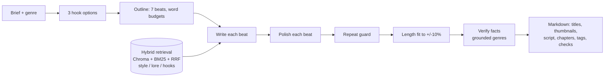

# Story Script RAG

Local, offline RAG system that writes first-person YouTube story scripts (horror, history mysteries, fantasy,
Cthulhu, or any genre you name) at a chosen length of 5, 10, 15 or 20 minutes. Everything is free and runs on one
consumer GPU (built and measured on an RTX 5060 Ti 16 GB, peak VRAM under 14.5 GB). The LLM runs on the GPU through
Ollama; embeddings, ChromaDB and BM25 run on the CPU.

## How it works

- **Three collections:** `scripts` (style examples), `lore` (facts) and `hooks`. Each is searched with dense vectors
  (bge-m3) and BM25, merged by reciprocal rank fusion, filtered by genre and by story beat.
- **Section by section:** the outline gives every beat a word budget; each beat is written with a rolling summary
  and the unused budget of earlier beats, then polished on its own. A whole-script polish made the 12B model loop,
  so it is not used.
- **Grounded history:** for fact-based genres the model tags facts `[S#]` (the lore chunk they came from) and wraps
  anything it invents as `{{INVENTED: ...}}`. A Verify step re-checks every sentence that carries a `[S#]` tag, plus sentences naming something with no citation, against the lore (at most 40 checks).
- **Guards:** repeated paragraphs and sentences are removed, the final length is steered to within 10% of the target,
  and passages with over 80% 5-gram overlap with a source are flagged.

## Results
Measured on this machine (num_ctx 16384). Rows other than the fantasy row were measured on an earlier model, before the switch to gemma4:12b. These are single runs; quality metrics swing a few points.

| Check | Result |
|---|---|
| Retrieval, 14 briefs (`cli.py eval --retrieval-only`) | right source at top 1: 0.90, top 3: 0.95, top 10: 0.95 |
| Three 5-min scripts (history / cthulhu / horror), target 750 words | 780 / 824 / 783 words, accuracy 96.0% / 90.1% / 95.6% |
| Repeated 4-grams in those scripts | 4.2% / 0.7% / 4.4% |
| Speed | about 4 min per 5-min script; generation is decode-bound at ~40 tokens/s |
| Polish stage with `OLLAMA_NUM_PARALLEL=2` | 18.7 s down to 12.0 s, peak GPU 11.8 to 13.3 GB |
| Fantasy 5-min script, two runs on gemma4:12b (target 750) | 753 / 762 words, accuracy 99.6% / 98.4%, repeats 0.3% / 1.6%, sentences 14.8 / 14.9 words, 407-695 s each, peak VRAM 10.7 GB |
| History 5-min script on gemma4:12b, after the Verify upgrade | 722 words (accuracy 96.3%), repeats 4.3%, sentences 14.4 words, 14 sentences marked `{{INVENTED}}`; an earlier history run on the same model gave 753 words, repeats 1.3% |
| Offline tests (no GPU, no Ollama) | 50 pass, including an end-to-end repeat guard that fails if the dedupe is removed |

Unedited excerpt (history, "The Mary Celeste", gemma4:12b; `{{INVENTED}}` marks claims the lore does not support, `[S1]` marks facts that do):
> On December 4, 1872, the *Dei Gratia* spotted her sailing erratically in the Atlantic [S1]. No one answered their signals, and a boarding party found the ship completely deserted [S1].
> {{INVENTED: The captain's log ended abruptly, leaving a haunting void in the official record.}}

## Design decisions (what I tested and why)
- **Cross-encoder reranker: off.** A MiniLM reranker gave no ranking gain and was 5x slower on CPU.
- **Parallel polish: 2 workers, not 3.** Three workers reached 14.8 GB VRAM, over the 14.5 GB budget.
- **Per-beat polish instead of whole-script polish.** The whole-script call made the model repeat paragraphs.
- **Repeats are guarded by tests, not hope.** A fake-LLM test re-tells earlier scenes and fails if any repeat reaches
  the script. A second test proves the guard can fail (it breaks the dedupe on purpose).
- **Length control accepts a rewrite only if it moves toward the target and adds no repeats.**
- **Sentence length needs an example, not another rule.** Five prompts already asked for 10-15 words and the model wrote 7.9. A before/after example plus a reason and a self-check moved it to about 12-13.
- **Cap section generation at about 1.8 tokens per word of budget.** The model wrote 3-5x small budgets, so retries and polish could not recover. The cap plus trimming the unfinished sentence brought scripts to 764-791 words.
- **The rolling summary is labelled "already told".** It was labelled "Summary" and the model retold it; relabelling cut repeated phrases from 8.8% to 2.2% in one run.
- **Invented bracket notes are stripped.** Only `[PAUSE]`, `[SFX:]`, `[B-ROLL:]` and `[S#]` survive.
- **gemma4:12b is the writing model.** In a same-brief test against the model it replaced it had better accuracy, fewer repeats and lower peak VRAM (10.7 GB), and more concrete prose, but it is 2-3x slower (407-695 s per 5-min script). Sentences run long at 14.8-14.9 words.
- **One sentence splitter.** Two checks once split sentences differently, so "J. Habakuk" counted as two sentences and a mid-sentence `[S1]` tag cut a claim in half before Verify judged it. All checks now share `checks.sentences()`.
- **Models:** gemma4:12b (writing) and BAAI/bge-m3 (embeddings). Models are not included; each has its own licence.

## Code layout
- `ragscript/pipeline.py`: the stages (hooks, outline, write, polish, length fit, package). `verify.py` is the Verify step, `sources.py` numbers the cited chunks.
- `ragscript/checks.py`: every pure text check (repeats, overlap, citations, length). `checks.sentences()` is the only sentence splitter.
- `ragscript/store.py` + `retrieve.py`: Chroma/BM25 index and hybrid search. `chunking.py`, `loaders.py`, `metadata.py` feed `ingest`.
- `ragscript/llm.py` (Ollama, OOM retry), `genre.py`, `render.py`, `vram.py`. Entry points: `cli.py`, `app.py`, `main.py`.
- `config.yaml` holds every tuning number (`length:`, `checks:`); `prompts/` holds the stage and genre prompts.

## Limitations
- Single user, single machine; no concurrency design beyond the polish step.
- Retrieval is judged on 14 briefs; script quality on the 3-brief check plus reading, not a user study.
- Average sentence length is now about 13-15 words (target 10-15); gemma4 runs at the long end. Read aloud before recording.
- The Verify step is strict: it can mark a true paraphrase as `INVENTED`, and the model still reuses atmosphere lines (a repeated-phrase rate of 4.3% showed up in one history run). Word-level repetition is not checked yet.
- History facts come from a small set of lore notes (6 topics). Fact-check every `{{INVENTED}}` mark and the
  Checks section before publishing.
- The books and scripts used as style data are **not** in this repository (see below).

## Setup
Needs Python 3.11 to 3.13 (tests also pass on 3.13) and Ollama (https://ollama.com).

**Data is not included.** Put your own `.txt .md .docx .pdf .epub` files in `data/<genre>/` (for example
`data/horror/`), name fact notes `lore_*.md`, then run `python cli.py ingest`. See "Adding your material" below.
Use only text you have the right to use.

Windows PowerShell:
```powershell
.\setup.ps1                  # venv, CPU torch, requirements, ollama pull gemma4:12b
.\.venv\Scripts\Activate.ps1
```
Linux: `bash setup.sh && source .venv/bin/activate`

bge-m3 (~2 GB) downloads on first ingest; after that everything runs offline.

## Use
```bash
python cli.py ingest                                   # incremental: only new/changed files are re-indexed
python cli.py hooks "A lighthouse keeper finds extra footprints" --genre horror
python cli.py write "The lost colony of Roanoke" --genre history --minutes 10 --hook 2
python cli.py write "A tech finds the ship AI is lying" --genre sci-fi --style "wry, practical details" --minutes 5
python app.py                                          # Gradio UI at http://127.0.0.1:7860
python main.py                                         # optional HTTP service on :8000 (/vector_store/query, /vector_store/insert) for the StoryForge pipeline
python cli.py eval [--retrieval-only]                  # 14 briefs in eval/briefs.yaml (also prints top-1/3/10 source ranks)
python cli.py eval --compare-rerank [MODEL]            # retrieval only: reranker off vs on, with timing
python -m eval.rerun3 <label>                          # 3 real 5-minute scripts -> output/<label>/ (about 13 min)
python -m eval.lore_check data/history/lore_*.md       # before ingesting lore: garbled text, front-matter, length, names/years seen once
pip install -r requirements-dev.txt && python -m pytest tests   # model-free self-checks
```
Output goes to `output/<genre>-<min>min-<slug>.md`: titles (5), thumbnail text (3), narration with
`[PAUSE]` / `[SFX: …]` / `[B-ROLL: …]` (the `## Script` section is clean: no `[S#]` tags, no `{{INVENTED}}` braces, ready to record), estimated chapters, description, tags, sources, and a Checks section. Grounded genres end with a **Fact-check copy** of the script that keeps every `[S#]` tag and `{{INVENTED}}` mark, so you can find what the Checks list names.

## Any genre
`--genre` (or the UI box) takes any name: "sci-fi", "true crime", "romance"… The name is lower-cased and hyphenated (`True Crime` → `true-crime`).
- Examples: put files in `data/<name>/` (use that lower-case, hyphenated folder name), then `ingest`. No folder means no style examples, but it still works.
- Rules: optional `prompts/<name>.md`. Without it, `prompts/default.md` is used (a warning is logged).
- Fact-grounded genres (true crime, science, biography): start the prompt file with `---\ngrounded: true\n---`. Facts then come only from `lore_*.md` notes, and invented details are marked `{{INVENTED: …}}`. `history.md` does this already.
- `--style "…"` / the UI field adds one-off style notes for a single script.
- The narrator is always first person and the story always uses the 7 beats.

## Adding your material
Drop files (`.txt .md .docx .pdf .epub .srt .vtt`) in `data/<genre>/` (e.g. `horror`, `history`, `fantasy`, `cthulhu`, or your own), then run `ingest`.
- Books: EPUB chapters are read in reading order; Project Gutenberg licence headers/footers, PDF page numbers and line-break hyphens are removed automatically (real compounds like mother-in-law are kept; if poppler's `pdftotext` is on PATH it is used, which also repairs books typeset with soft hyphens). Scanned PDFs (images) have no text and need OCR first.
- **Past scripts** → style collection. Optional YAML front-matter: `subgenre, tone, pov, views, retention`. Missing tags are filled once by the LLM (cached by file hash).
- **Lore/facts** → name the file `lore_*.md` (or front-matter `kind: lore`).
- **Hooks/endings** → `data/hooks/*.md`: blocks separated by a `---` line, first line `TYPE: hook` or `TYPE: ending`. Each script's first and last beat are also added automatically.
- Beat chunking uses `## Hook / Setup / Rising tension / Reveal / Climax / Aftermath / Outro` headings (or `[BEAT: climax]`). Without them, 300-500 token chunks with 15% overlap are used and beats are estimated from position.
- Delete a file and the next `ingest` removes it from the index.

## Customising
- `config.yaml`: model, `num_ctx`, retrieval sizes, reranker on/off (`reranker.enabled`), words per minute, the `length:` and `checks:` thresholds the README results were tuned with.
- `prompts/<genre>.md` genre rules; `prompts/stages/*.md` stage templates (placeholders look like `<<name>>`).
- `banned_phrases.txt`: one phrase per line; used in the prompts and checked after generation (one rewrite attempt, then listed in Checks).
- Swap model: `ollama pull mistral-nemo` then set `llm.model: mistral-nemo`. Models without thinking support are detected automatically.

## Fact-checking and quality checks
Grounded genres take facts only from retrieved lore (`[S#]`); anything invented is wrapped as `{{INVENTED: …}}` and listed under Checks. After polishing, the **Verify step** asks the model YES/NO ("does the lore state this?", lore as sole evidence) for every cited sentence and every sentence that names something without a citation (at most 40 checks); each NO becomes `{{INVENTED}}`. This reduces but cannot eliminate invention, and paraphrases can be mis-marked: fact-check before publishing. The sample lore notes were written from memory, so verify them too.

Every output also reports word-count accuracy, repeated-phrase rate, banned-phrase hits, and passages with >80% 5-gram overlap with a source chunk.

## Optional: parallel polish
To polish 2 sections at once, set the Ollama server variable `OLLAMA_NUM_PARALLEL=2` (PowerShell: `[Environment]::SetEnvironmentVariable("OLLAMA_NUM_PARALLEL","2","User")`, then restart Ollama) **and** `llm.parallel: 2` in `config.yaml`. Polish went 18.7 s → 12.0 s (peak GPU 11.8 → 13.3 GB); 3 workers hit 14.8 GB, over budget. Undo with `SetEnvironmentVariable("OLLAMA_NUM_PARALLEL",$null,"User")`.

## VRAM troubleshooting
Every stage logs VRAM/RAM and warns above 14.5 GB. On out-of-memory the LLM wrapper halves `num_ctx` (down to `llm.min_ctx`) and retries. If it still fails: lower `llm.num_ctx` (12288/8192), set `llm.keep_alive: 0`, close other GPU apps, or use a smaller model. Embeddings are CPU-only.
