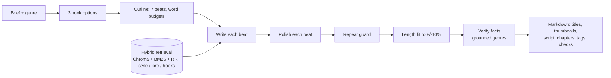

# Story Script RAG

Local, offline RAG system that writes first-person YouTube story scripts (horror, history mysteries, fantasy,
Cthulhu, or any genre you name) at a chosen length of 5, 10, 15 or 20 minutes. Everything is free and runs on one
consumer GPU (built and measured on an RTX 5060 Ti 16 GB, peak VRAM under 14.5 GB). The LLM runs on the GPU through
Ollama; embeddings, ChromaDB and BM25 run on the CPU.

## How it works

- **Three collections:** `scripts` (style examples), `lore` (facts) and `hooks`. Each is searched with dense vectors
  (bge-m3) and BM25, merged by reciprocal rank fusion, filtered by genre and by story beat.
- **Section by section:** the outline gives every beat a word budget; each beat is written with a rolling summary
  and the unused budget of earlier beats, then polished on its own. A whole-script polish made the 12B model loop,
  so it is not used.
- **Grounded history:** for fact-based genres the model tags facts `[S#]` (the lore chunk they came from) and wraps
  anything it invents as `{{INVENTED: ...}}`. A Verify step re-checks the sentences the code flags against the lore.
- **Guards:** repeated paragraphs and sentences are removed, the final length is steered to within 10% of the target,
  and passages with over 80% 5-gram overlap with a source are flagged.

## Results
Measured on this machine (gemma3:12b, num_ctx 16384). These are single runs; quality metrics swing a few points.

| Check | Result |
|---|---|
| Retrieval, 14 briefs (`cli.py eval --retrieval-only`) | right source at top 1: 0.90, top 3: 0.95, top 10: 0.95 |
| Three 5-min scripts (history / cthulhu / horror), target 750 words | 780 / 824 / 783 words, accuracy 96.0% / 90.1% / 95.6% |
| Repeated 4-grams in those scripts | 4.2% / 0.7% / 4.4% |
| Speed | about 4 min per 5-min script; generation is decode-bound at ~40 tokens/s |
| Polish stage with `OLLAMA_NUM_PARALLEL=2` | 18.7 s down to 12.0 s, peak GPU 11.8 to 13.3 GB |
| Offline tests (no GPU, no Ollama) | 38 pass, including an end-to-end repeat guard that fails if the dedupe is removed |

Unedited excerpt (history, "The Mary Celeste", `{{INVENTED}}` marks details the lore does not support):
> The ship's bell felt strangely cold in my hand [S1]. I am cataloging artifacts from the *Mary Celeste* now [S1].
> {{INVENTED: Records show Captain Briggs last touched it.}} Why would someone abandon a ship in perfect condition?

## Design decisions (what I tested and why)
- **Cross-encoder reranker: off.** A MiniLM reranker gave no ranking gain and was 5x slower on CPU.
- **Parallel polish: 2 workers, not 3.** Three workers reached 14.8 GB VRAM, over the 14.5 GB budget.
- **Per-beat polish instead of whole-script polish.** The whole-script call made the model repeat paragraphs.
- **Repeats are guarded by tests, not hope.** A fake-LLM test re-tells earlier scenes and fails if any repeat reaches
  the script. A second test proves the guard can fail (it breaks the dedupe on purpose).
- **Length control accepts a rewrite only if it moves toward the target and adds no repeats.**
- **Models:** gemma3:12b (writing) and BAAI/bge-m3 (embeddings). Models are not included; each has its own licence.

## Limitations
- Single user, single machine; no concurrency design beyond the polish step.
- Retrieval is judged on 14 briefs; script quality on the 3-brief check plus reading, not a user study.
- Average sentence length is about 7-8 words (target 10-15), so narration can sound choppy; read aloud before recording.
- History facts come from a small set of lore notes (6 topics). Fact-check every `{{INVENTED}}` mark and the
  Checks section before publishing.
- The books and scripts used as style data are **not** in this repository (see below).

## Setup
Needs Python 3.11 or 3.12 and Ollama (https://ollama.com).

**Data is not included.** Put your own `.txt .md .docx .pdf .epub` files in `data/<genre>/` (for example
`data/horror/`), name fact notes `lore_*.md`, then run `python cli.py ingest`. See "Adding your material" below.
Use only text you have the right to use.

Windows PowerShell:
```powershell
.\setup.ps1                  # venv, CPU torch, requirements, ollama pull gemma3:12b
.\.venv\Scripts\Activate.ps1
```
Linux: `bash setup.sh && source .venv/bin/activate`

bge-m3 (~2 GB) downloads on first ingest; after that everything runs offline.

## Use
```bash
python cli.py ingest                                   # incremental: only new/changed files are re-indexed
python cli.py hooks "A lighthouse keeper finds extra footprints" --genre horror
python cli.py write "The lost colony of Roanoke" --genre history --minutes 10 --hook 2
python cli.py write "A tech finds the ship AI is lying" --genre sci-fi --style "wry, practical details" --minutes 5
python app.py                                          # Gradio UI at http://127.0.0.1:7860
python main.py                                         # optional HTTP service on :8000 (/vector_store/query, /vector_store/insert) for the StoryForge pipeline
python cli.py eval [--retrieval-only]                  # 14 briefs in eval/briefs.yaml (also prints top-1/3/10 source ranks)
python cli.py eval --compare-rerank [MODEL]            # retrieval only: reranker off vs on, with timing
python -m eval.rerun3 <label>                          # 3 real 5-minute scripts -> output/<label>/ (about 13 min)
python -m eval.lore_check data/history/lore_*.md       # before ingesting lore: garbled text, front-matter, length, names/years seen once
pip install -r requirements-dev.txt && python -m pytest tests   # model-free self-checks
```
Output goes to `output/<genre>-<min>min-<slug>.md`: titles (5), thumbnail text (3), narration with
`[PAUSE]` / `[SFX: …]` / `[B-ROLL: …]`, estimated chapters, a **Clean narration** copy for recording (no `[S#]` tags, `{{INVENTED}}` unwrapped, cues kept; the `## Script` section keeps every marker for fact-checking), description, tags, sources, and a Checks section.

## Any genre
`--genre` (or the UI box) takes any name: "sci-fi", "true crime", "romance"… The name is lower-cased and hyphenated (`True Crime` → `true-crime`).
- Examples: put files in `data/<name>/` (use that lower-case, hyphenated folder name), then `ingest`. No folder means no style examples, but it still works.
- Rules: optional `prompts/<name>.md`. Without it, `prompts/default.md` is used (a warning is logged).
- Fact-grounded genres (true crime, science, biography): start the prompt file with `---\ngrounded: true\n---`. Facts then come only from `lore_*.md` notes, and invented details are marked `{{INVENTED: …}}`. `history.md` does this already.
- `--style "…"` / the UI field adds one-off style notes for a single script.
- The narrator is always first person and the story always uses the 7 beats.

## Adding your material
Drop files (`.txt .md .docx .pdf .epub .srt .vtt`) in `data/<genre>/` (e.g. `horror`, `history`, `fantasy`, `cthulhu`, or your own), then run `ingest`.
- Books: EPUB chapters are read in reading order; Project Gutenberg licence headers/footers, PDF page numbers and line-break hyphens are removed automatically. Scanned PDFs (images) have no text and need OCR first.
- **Past scripts** → style collection. Optional YAML front-matter: `subgenre, tone, pov, views, retention`. Missing tags are filled once by the LLM (cached by file hash).
- **Lore/facts** → name the file `lore_*.md` (or front-matter `kind: lore`).
- **Hooks/endings** → `data/hooks/*.md`: blocks separated by a `---` line, first line `TYPE: hook` or `TYPE: ending`. Each script's first and last beat are also added automatically.
- Beat chunking uses `## Hook / Setup / Rising tension / Reveal / Climax / Aftermath / Outro` headings (or `[BEAT: climax]`). Without them, 300-500 token chunks with 15% overlap are used and beats are estimated from position.
- Delete a file and the next `ingest` removes it from the index.

## Customising
- `config.yaml`: model, `num_ctx`, retrieval sizes, reranker on/off (`reranker.enabled`), words per minute, thresholds.
- `prompts/<genre>.md` genre rules; `prompts/stages/*.md` stage templates (placeholders look like `<<name>>`).
- `banned_phrases.txt`: one phrase per line; used in the prompts and checked after generation (one rewrite attempt, then listed in Checks).
- Swap model: `ollama pull mistral-nemo` then set `llm.model: mistral-nemo` (or `gemma3:12b`). Models without thinking support are detected automatically.

## History scripts and fact-checking
Facts must come from retrieved lore chunks (`[S#]`). Anything the model invents is wrapped as `{{INVENTED: …}}` and listed under Checks → *Invented details*. This reduces but cannot eliminate invention: fact-check before publishing. The sample lore notes were written from memory, so verify them too.

## Verify step (fact-grounded genres only)
After polishing, the code collects sentences that name something (a name, date or number) with no `[S#]` citation, or whose cited numbers/quotes are missing from the cited lore. The model then answers YES/NO for each one ("does the lore state this?", lore as sole evidence, at most 12 checks). Every NO is wrapped as `{{INVENTED: …}}` automatically, so it lands in the fact-check list. It only judges sentences the code flagged, so paraphrased claims can still slip through.

## Quality checks (in every output)
Passages with >80% 5-gram overlap with a retrieved source chunk are flagged; word-count accuracy; repeated-phrase rate; banned-phrase hits.

## Optional: parallel polish (small speed-up)
The per-section polish calls are independent. To run 2 at once: set the Ollama server variable `OLLAMA_NUM_PARALLEL=2` (PowerShell: `[Environment]::SetEnvironmentVariable("OLLAMA_NUM_PARALLEL","2","User")`, then quit and restart Ollama) **and** set `llm.parallel: 2` in `config.yaml`. Measured with gemma3:12b: polish 18.7 s → 12.0 s, peak GPU 11.8 → 13.3 GB. 3 workers reached 14.8 GB, over the 14.5 GB budget. Undo with `SetEnvironmentVariable("OLLAMA_NUM_PARALLEL",$null,"User")`.

## VRAM troubleshooting
Every stage logs VRAM/RAM (`nvidia-smi` + psutil) and warns above 14.5 GB. On an out-of-memory error the LLM wrapper halves `num_ctx` (down to `llm.min_ctx`) and retries, and retrieval shrinks with it.
If it still fails: lower `llm.num_ctx` (12288/8192), set `llm.keep_alive: 0` to unload between runs, close other GPU apps, or use a smaller model/quant. Embeddings and reranker are CPU-only and never use VRAM.

## Limits
A 14B model gives solid but not top-tier long-form prose; expect 10-25 min of generation for a 20-min script. Check the Checks section and read the script aloud before recording.
