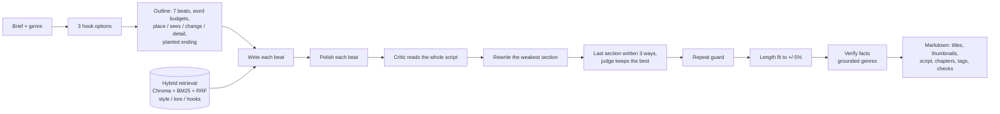

# Story Script RAG

Local, offline RAG system that writes first-person story scripts (horror, history mysteries, fantasy, Cthulhu, sci-fi, literary, or any genre you name) at a chosen length of 5, 10, 15 or 20 minutes. Everything is free and runs on one consumer GPU (built and measured on an RTX 5060 Ti 16 GB, peak VRAM under 14.5 GB). The LLM runs on the GPU through Ollama; embeddings, ChromaDB and BM25 run on the CPU.

## How it works

- **Retrieval:** three collections (`scripts` for style, `lore` for facts, `hooks`), each searched with dense vectors (bge-m3) and BM25, merged by reciprocal rank fusion, and filtered by genre and story beat.
- **A planned story:** the outline gives every beat a word budget, a place, what the narrator looks at, one new event and a recurring detail, and it plants the ending early. Code checks the outline for holes and asks for one repair.
- **Checks that catch what a small model misses:** a critic call plus code checks for dropped objects used again and details that come back too often; the weakest section is rewritten once, and a fix is kept only if a second look agrees.
- **Guards:** repeated and retold paragraphs are removed, and the length is steered to within 5% of the target.
- **Grounded history:** facts are tagged `[S#]` to their lore chunk, invented details are wrapped as `{{INVENTED: ...}}`, and a Verify step re-checks them.

Details: [architecture](docs/architecture.md), [design decisions](docs/design-decisions.md) (what I tested and why), [guide](docs/guide.md) (commands, adding material, tuning).

## Results
Measured on this machine (`num_ctx` 16384). Single runs; quality metrics swing a few points.

| Check | Result |
|---|---|
| Retrieval, 17 briefs (`cli.py eval --retrieval-only`) | right source at top 1: 0.87, top 3: 0.91, top 10: 0.91; 16 of 17 briefs hit. Measured before 100 fantasy stories and two novels were added |
| Three briefs (horror, history, Cthulhu), 5 min, target 750 | accuracy 97.1% mean (736-780 words), repeats 3.1%, no tense switches, 1.0 `[PAUSE]` per minute, sentences 15.6 words |
| Three briefs (horror, fantasy, sci-fi), 5 min, planned ending | accuracy 99.3%, repeats 2.2% (1.0% outside the setting words), no detail over its limit, sentences 15.7 words |
| History 5-min script with Verify | 722 words (96.3%), repeats 4.3%, 14 sentences marked `{{INVENTED}}` |
| Speed | about 2.5-7 min per 5-min script (about 1 more with the ending choice); decode-bound at ~40-45 tokens/s |
| Offline tests (no GPU, no Ollama) | 105 pass, including an end-to-end repeat guard that fails if the dedupe is removed |

Unedited excerpt (history, "The Mary Celeste", gemma4:12b; `{{INVENTED}}` marks claims the lore does not support, `[S1]` marks facts that do):
> On December 4, 1872, the *Dei Gratia* spotted her sailing erratically in the Atlantic [S1]. No one answered their signals, and a boarding party found the ship completely deserted [S1].
> {{INVENTED: The captain's log ended abruptly, leaving a haunting void in the official record.}}

## Quick start
Needs Python 3.11 to 3.13 and [Ollama](https://ollama.com). **Data is not included:** put your own `.txt .md .docx .pdf .epub` files in `data/<genre>/` (for example `data/horror/`), name fact notes `lore_*.md`, and use only text you have the right to use.

```powershell
.\setup.ps1                  # venv, CPU torch, requirements, ollama pull gemma4:12b
.\.venv\Scripts\Activate.ps1
```
Linux: `bash setup.sh && source .venv/bin/activate`. bge-m3 (~2 GB) downloads on first ingest; after that everything runs offline.

```bash
python cli.py ingest                                   # index data/ (incremental)
python cli.py hooks "A lighthouse keeper finds extra footprints" --genre horror
python cli.py write "The lost colony of Roanoke" --genre history --minutes 10 --hook 2
python app.py                                          # Gradio UI at http://127.0.0.1:7860
python cli.py eval --ids b01,b03,b08 --minutes 5 --label NAME   # quick regression on 3 briefs
python cli.py compare NAME_A NAME_B                    # which of two eval runs is better (pairwise judge)
python -m pytest tests                                 # offline self-checks (pip install -r requirements-dev.txt)
```
Output goes to `output/<genre>-<min>min-<slug>-<MMDD-HHMMSS>.md`: titles, thumbnail text, a clean narration ready to record, estimated chapters, description, tags, sources and a Checks section. More commands and options are in the [guide](docs/guide.md).

## Limitations
- Single user, single machine; no concurrency design beyond the polish step.
- Script quality is judged on a few briefs plus reading, not a user study. Repetition is reduced, not solved (repeated-phrase rates ranged from 1.9% to 6.7% across horror runs).
- Sentences average 15-16 words (target 12-16); read aloud before recording.
- The Verify step is strict and can mark a true paraphrase as `INVENTED`. History facts come from a small set of lore notes (10 topics): fact-check every `{{INVENTED}}` mark and the Checks section before publishing.
- The logic checks are word matches with no tagger; they miss paraphrases and can flag an object another character took.
- The books and scripts used as style data are **not** in this repository.

## Built with AI assistance
This project was developed with the help of AI tools: Claude (Claude Code, with plugins for prompt engineering, refactoring and code review) and Cursor. I chose what to build, picked the data, ran the tests and generation runs on my own GPU, and decided what to keep.
